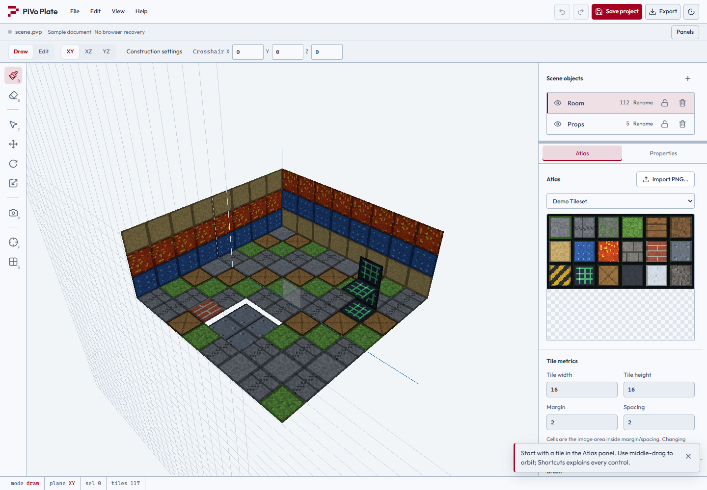

# PiVo Plate

A local-first browser tile-to-3D modeling editor.

[Open app](https://bookklik-technologies.github.io/pivo-plate/) · [Documentation](https://bookklik-technologies.github.io/pivo-plate/docs/)



## Run locally

Use Node.js 24 and npm.

```sh
npm ci
npm run dev
```

Open the local URL printed by Vite. Requires a current desktop browser with WebGL2. Projects stay in your browser; save downloaded project files as backups.

## Build and documentation

```sh
npm run build         # production app in dist/
npm run docs:dev      # local documentation server
npm run docs:build    # static docs in docs/.vitepress/dist/
npm run docs:preview  # preview docs after building
```

See the [tutorials](https://bookklik-technologies.github.io/pivo-plate/docs/tutorials/), [limitations](docs/limitations.md), and [verification](docs/verification.md) for usage, supported features, and recorded checks.

## License

Released under the [MIT License](LICENSE). See [third-party notices](THIRD_PARTY_NOTICES.md) for dependency licenses.

## Production readiness

See [readiness findings and release procedure](docs/production-readiness.md). Unit tests are manual; pull-request checks cover builds, dependency exceptions and browser workflows.
